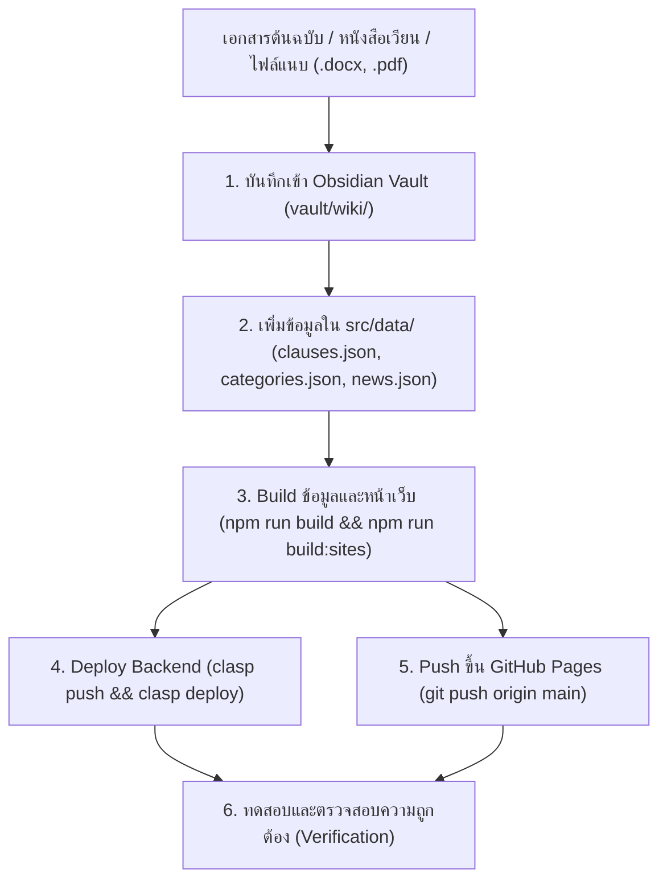

# Rights & Welfare Platform: Content & Regulation Update SOP

คู่มือขั้นตอนมาตรฐานสำหรับการเพิ่ม ปรับปรุง และเผยแพร่ข้อมูลระเบียบ สิทธิประโยชน์ หนังสือเวียน และข่าวสาร ในระบบ **สิทธิประโยชน์และสวัสดิการ PEA** (ครอบคลุมทั้ง Obsidian, JSON Data, Google Apps Script Backend, และ GitHub Pages / Google Sites Frontend)

---

## 1. ผังขั้นตอนการอัปเดตข้อมูล (End-to-End Workflow)



---

## 2. ขั้นตอนปฏิบัติอย่างละเอียด (Step-by-Step Instructions)

### ขั้นตอนที่ 1: บันทึกข้อมูลลง Obsidian Vault

1. **สร้างไฟล์แหล่งอ้างอิง (Source Note):**
   - บันทึกไว้ที่ `vault/wiki/sources/<เลขที่หนังสือ/ชื่อเรื่อง>.md`
   - ใส่ Frontmatter: `title`, `date`, `source`, `category`, `tags`
   - สรุปสาระสำคัญ เกณฑ์ เงื่อนไข อัตรา และเบอร์ติดต่อ

2. **เชื่อมโยงไปยังหมวดสวัสดิการที่เกี่ยวข้อง (Welfare Note):**
   - เช่น อัปเดตไฟล์ `vault/wiki/welfare/รายการค่ารักษาที่เบิกได้และเบิกไม่ได้.md` หรือไฟล์ที่เกี่ยวข้อง โดยทำลิงก์แบบ `[[...]]`

---

### ขั้นตอนที่ 2: เพิ่มข้อมูลใน `src/data/` (Single Source of Truth)

#### กรณี ก: เพิ่มข้อระเบียบหรือแนวทางปฏิบัติในคู่มือ (`clauses.json` & `categories.json`)

1. **ตรวจสอบว่าเป็นข้อระเบียบที่มีเลขข้อ หรือเป็นแนวทางปฏิบัติ (ไม่ระบุเลขข้อ):**
   - **กรณีมีเลขข้อ (1–44):**
     - กำหนด `num`: เป็นตัวเลข (เช่น `45`)
   - **กรณีไม่มีเลขข้อ (เช่น หนังสือเวียน/หลักเกณฑ์เพิ่มเติม):**
     - กำหนด `num`: เป็นสตริงรหัสเฉพาะ เช่น `"guidelines-weight-loss-pen"`
     - กำหนด `"noNum": true` เพื่อให้ UI แสดงป้ายไอคอน `แนวทาง` แทนป้าย `ข้อ XX`

2. **โครงสร้างของ Clause ใน `src/data/clauses.json`:**
   ```json
   {
     "num": "guidelines-weight-loss-pen",
     "noNum": true,
     "cat": "cat-guidelines",
     "title": "หลักเกณฑ์และแนวทางการเบิกจ่ายค่ารักษาพยาบาลด้วยวิธีปักปากกาควบคุมน้ำหนัก หรือ Weight Loss Injection Pen",
     "short": "สรุปสั้น 1-2 บรรทัดสำหรับแสดงในผลการค้นหาและการ์ด",
     "content": "<div class=\"space-y-4\">...HTML ที่จัดแต่งด้วย Tailwind classes...</div>"
   }
   ```

3. **อัปเดตหมวดหมู่ใน `src/data/categories.json`:**
   - หากเป็นหมวดใหม่ เช่น `cat-guidelines` ("หลักเกณฑ์และแนวทางอื่น ๆ"):
     ```json
     {
       "id": "cat-guidelines",
       "name": "หลักเกณฑ์และแนวทางอื่น ๆ",
       "icon": "fa-clipboard-check",
       "clauses": ["guidelines-weight-loss-pen"]
     }
     ```
   - เพิ่ม ID ลงในหมวดหมู่ `"all"` หรืออัปเดตชื่อหมวดหมู่ `"all"` ให้ครอบคลุม

---

#### กรณี ข: เพิ่มข่าวด่วน / แถบวิ่ง / ป๊อปอัปแจ้งเตือน (`news.json`)

ไฟล์: `src/data/news.json`
```json
{
  "news": [
    {
      "id": "news-2569-weight-loss-pen",
      "title": "หลักเกณฑ์การเบิกจ่ายปากกาควบคุมน้ำหนัก (Weight Loss Injection Pen)",
      "date": "2026-08-27",
      "summary": "สรุปสั้นสำหรับแถบวิ่ง News Ticker",
      "badge": "ใหม่",
      "urgent": true,
      "targetPage": "manual.html",
      "targetNum": "guidelines-weight-loss-pen",
      "tags": ["ค่ารักษาพยาบาล", "หนังสือเวียน", "เบิกจ่าย"],
      "contentHtml": "<p>รายละเอียดสำหรับ Popup Modal ที่จะเด้งอัตโนมัติ...</p>"
    }
  ]
}
```

> **หมายเหตุการทำงานของ News:**
> - `urgent: true`: ระบบจะเปิด Popup Modal อัตโนมัติเมื่อผู้ใช้เข้าหน้าแรก (1 ครั้งต่อเซสชัน ควบคุมด้วย `sessionStorage`)
> - `targetPage` & `targetNum`: เมื่อคลิกข่าว จะนำทางไปยังหน้าคู่มือและกางหัวข้อนั้นให้อัตโนมัติ

---

### ขั้นตอนที่ 3: Build ข้อมูลและหน้าเว็บ (Build Pipeline)

รันคำสั่งต่อไปนี้ใน Terminal / PowerShell:

```powershell
# 1. คอมไพล์ Knowledge Base (Obsidian -> Knowledge.js) และ Data (JSON -> Data.js)
npm run build

# 2. คอมไพล์หน้าเว็บ HTML ทั้งหมดไปยัง dist/sites/ และ docs/ (สำหรับ GitHub Pages)
npm run build:sites
```

**ผลลัพธ์ที่ต้องตรวจสอบ:**
- `Knowledge.js`: ขนาดไฟล์และจำนวนหน้าอัปเดต
- `Data.js`: เวอร์ชัน hash เปลี่ยน และจำนวน clauses เพิ่มขึ้น
- `dist/sites/*.html` และ `docs/*.html` ถูกสร้างขึ้นครบทุกหน้า

---

### ขั้นตอนที่ 4: Deploy Google Apps Script Backend

เมื่อ `apps-script/Data.js` หรือ `Knowledge.js` เปลี่ยนแปลง ต้อง deploy backend:

```powershell
# อัปโหลดโค้ดไปยัง Apps Script
npx clasp push

# Deploy เวอร์ชันใหม่ (ใช้ Deployment ID เดิมของ Web App)
npx clasp deploy -i AKfycbxuj4rSSQDzlcSCVv6QmT_vLcud5P2csRg55FcW4Wa920p4u3KCz-HPtO9gFvVVjwr3 -d "Update data and guidelines"
```

---

### ขั้นตอนที่ 5: Commit & Push ขึ้น GitHub Pages

เพื่ออัปเดตหน้าเว็บ GitHub Pages (`https://khunpsc.github.io/Rights-Wellfares/`):

```powershell
# ตรวจสอบไฟล์ที่เปลี่ยนแปลง
git status

# สเตจและคอมมิต
git add .
git commit -m "feat: add weight loss pen circular and guidelines section"

# พุชขึ้นกิ่ง main
git push origin main
```

**ติดตามสถานะ GitHub Actions Deployment:**
```powershell
gh run list --limit 3
# หรือ
gh run watch <RUN_ID>
```

---

### ขั้นตอนที่ 6: Checklist การทดสอบความถูกต้อง (Verification)

1. [ ] **หน้าหลัก (`home.html`):**
   - แถบวิ่ง News Ticker แสดงหัวข้อข่าวใหม่ถูกต้อง
   - ป๊อปอัป Modal เด้งขึ้นมาพร้อมเนื้อหาครบถ้วน และมีปุ่มกดลิงก์ไปยังคู่มือ
2. [ ] **หน้าคู่มือ (`manual.html`):**
   - แถบ Sidebar ด้านซ้ายแสดงหมวดหมู่ใหม่ (เช่น `หลักเกณฑ์และแนวทางอื่น ๆ`) พร้อมจำนวนรายการที่ถูกต้อง
   - การ์ดหัวข้อใหม่แสดงป้าย `แนวทาง` หรือไอคอนอย่างถูกต้อง (ไม่ขึ้น `ข้อ undefined`)
   - กาง/หุบ (Accordion) ได้ปกติ
   - ฟังก์ชันค้นหา (Search) พิมพ์คำค้นแล้วพบรายการนี้
   - ทดสอบ Deep Link: `manual.html?clause=<id>` สามารถเปิดและเลื่อนจอมาที่การ์ดนั้นได้อัตโนมัติ
3. [ ] **AI Chatbot:**
   - ทดสอบถามคำถามเกี่ยวกับหัวข้อใหม่ เช่น *"เบิกปากกาลดน้ำหนักได้ไหม"* -> Chatbot ตอบได้ตรงตามหลักเกณฑ์
