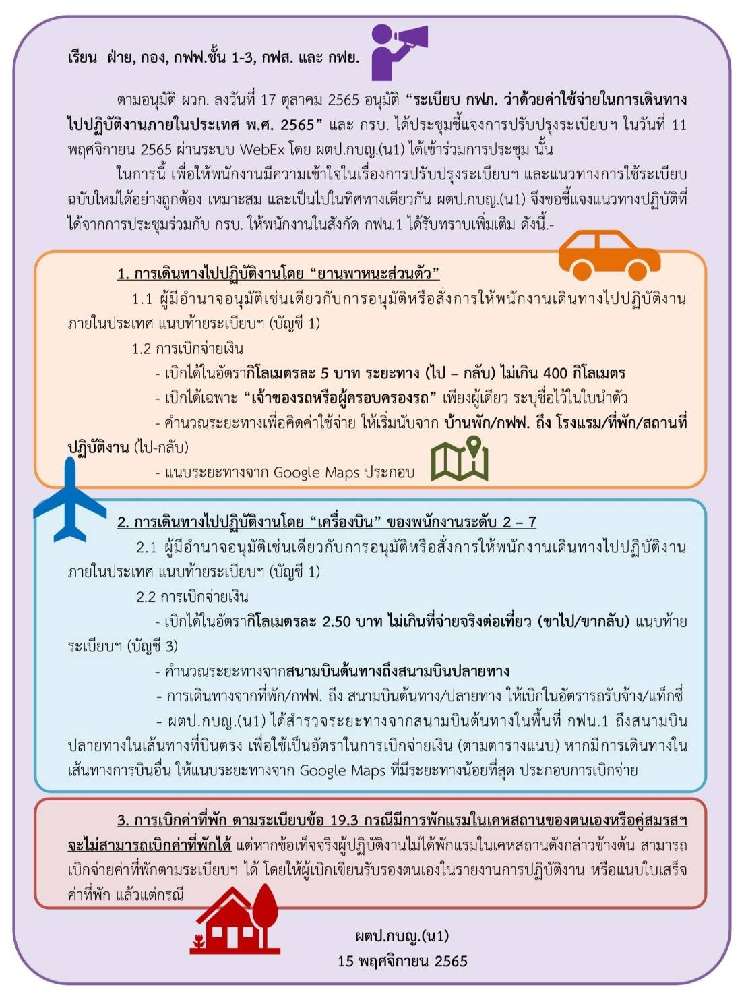
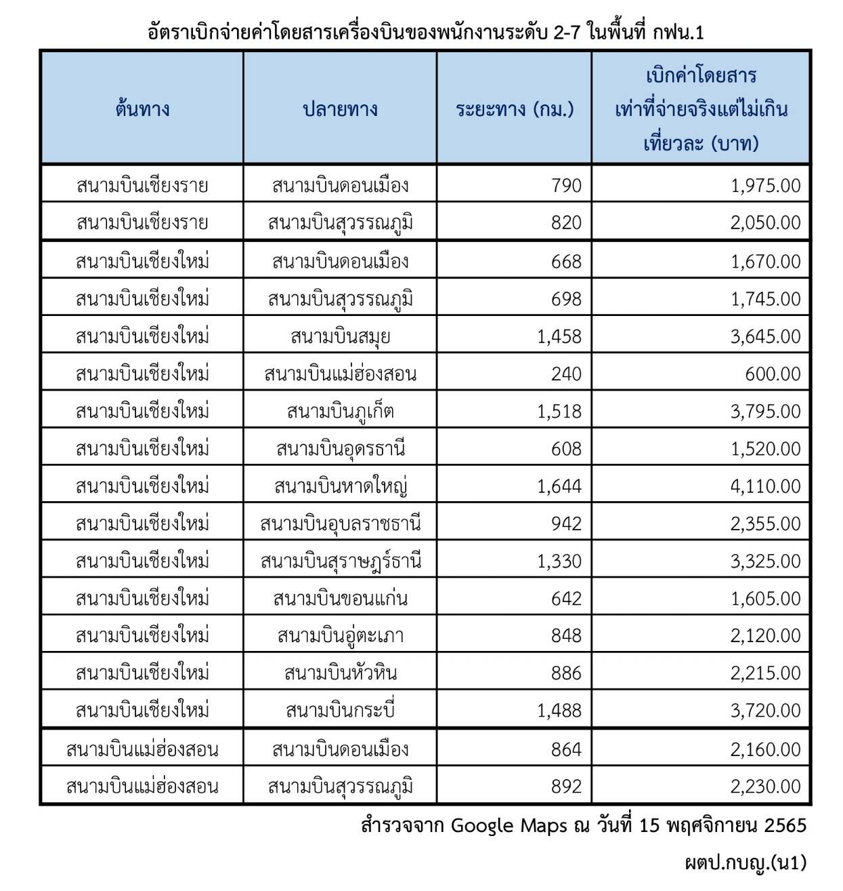
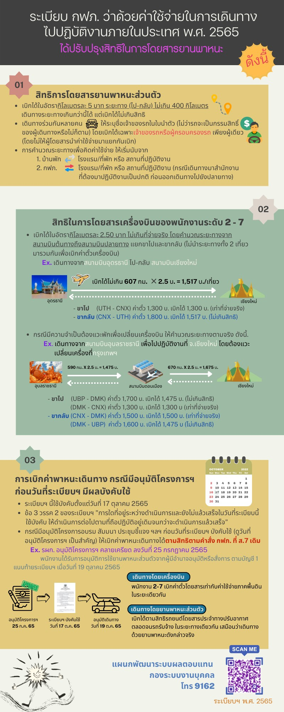

ที่มา: คำสั่ง กฟภ. ที่ ส.7 เรื่อง ค่าใช้จ่ายในการเดินทางไปปฏิบัติงานภายในประเทศ และระเบียบ/หลักเกณฑ์ที่เกี่ยวข้อง

> **หมายเหตุ:** คำสั่ง ส.7 ถูกรวมเป็น **ระเบียบ กฟภ. ว่าด้วยค่าใช้จ่ายในการเดินทางไปปฏิบัติงานภายในประเทศ พ.ศ. 2565** (ประกาศ 17 ต.ค. 2565) ซึ่งออกหลังคู่มือนี้ หลักการส่วนใหญ่คงเดิม ยกเว้นเรื่องที่มีหมายเหตุกำกับไว้ในบทนี้ · อัตราเบี้ยเลี้ยงและค่าเช่าที่พักปัจจุบันดูที่หน้า "อัตราเบี้ยเลี้ยง-ที่พัก"

## ทั่วไป

### 1. พนักงานที่มีสิทธิเบิกค่าใช้จ่ายในการเดินทางตามคำสั่งนี้
- 1.1 พนักงาน ซึ่งได้มีคำสั่งบรรจุและแต่งตั้งให้ดำรงตำแหน่งหน้าที่ประจำ
- 1.2 พนักงานทดลองงาน ให้มีสิทธิเบิกค่าใช้จ่ายได้เฉพาะค่าเช่าที่พักและค่าพาหนะเดินทาง (หากมีการไปปฏิบัติงานหลังจากครบกำหนดทดลองงานแล้ว ให้เบิกจ่ายค่าเช่าที่พักและค่าพาหนะเดินทางไปก่อน เมื่อได้รับคำสั่งบรรจุแล้ว จึงนำมาเบิกจ่ายย้อนหลังอีกครั้งหนึ่ง)

### 2. ผู้มีอำนาจอนุมัติหรือสั่งการให้พนักงานเดินทางไปปฏิบัติงานภายในประเทศ
(กสร.(ปร)210/55 ลว. 9 มี.ค. 55)

#### ผจก.กฟย. และพนักงานในสังกัด กฟย.
| ลักษณะงานที่ไปปฏิบัติ | ผู้มีอำนาจอนุมัติหรือสั่งการ |
|---|---|
| 1. ไปปฏิบัติงานในหน้าที่ ในพื้นที่ซึ่งอยู่ในความรับผิดชอบ กฟย. นั้น | ผจก.กฟย. หรือผู้บังคับบัญชาเหนือชั้นขึ้นไป |
| 2. ไปปฏิบัติงานในหน้าที่ ที่หน่วยงานซึ่งเป็นต้นสังกัด | ผจก.กฟย. หรือผู้บังคับบัญชาเหนือชั้นขึ้นไป |
| 3. ไปปฏิบัติงานในหน้าที่ ที่ กฟฟ.อื่น ซึ่งขึ้นอยู่กับหน่วยงานต้นสังกัดเดียวกัน | ผจก.กฟฟ.ต้นสังกัด หรือผู้บังคับบัญชาเหนือชั้นขึ้นไป |
| 4. ไปปฏิบัติงานในหน้าที่ ที่ กฟข.ต้นสังกัด | ผจก.กฟฟ.ต้นสังกัด หรือผู้บังคับบัญชาเหนือชั้นขึ้นไป |
| 5. ไปปฏิบัติงานในหน้าที่ ที่ กฟฟ.อื่น ซึ่งอยู่นอกพื้นที่รับผิดชอบของ กฟฟ.ต้นสังกัด แต่อยู่ในเขตเดียวกัน | ผชก. หรือผู้ที่ได้รับมอบหมาย |
| 6. ไปปฏิบัติงานในหน้าที่ ที่สำนักงานใหญ่ | ผชก. หรือผู้ที่ได้รับมอบหมาย |
| 7. ไปปฏิบัติงานในหน้าที่นอก กฟข.ต้นสังกัด | รผก.(ภ) หรือผู้ที่ได้รับมอบหมาย |
| 8. ไปปฏิบัติงานภารกิจอื่น | ผวก. |

#### ผจก.กฟส. และพนักงานในสังกัด กฟส.
| ลักษณะงานที่ไปปฏิบัติ | ผู้มีอำนาจอนุมัติหรือสั่งการ |
|---|---|
| 1. ไปปฏิบัติงานในหน้าที่ ในพื้นที่ซึ่งอยู่ในความรับผิดชอบ กฟส. นั้น | ผจก.กฟส. หรือผู้บังคับบัญชาเหนือชั้นขึ้นไป |
| 2. ไปปฏิบัติงานในหน้าที่ ที่หน่วยงานซึ่งเป็นต้นสังกัด | ผจก.กฟส. หรือผู้บังคับบัญชาเหนือชั้นขึ้นไป |
| 3. ไปปฏิบัติงานในหน้าที่ ที่ กฟฟ.อื่น ซึ่งขึ้นอยู่กับหน่วยงานต้นสังกัดเดียวกัน | ผจก.กฟฟ.ต้นสังกัด หรือผู้บังคับบัญชาเหนือชั้นขึ้นไป |
| 4. ไปปฏิบัติงานในหน้าที่ ที่ กฟข.ต้นสังกัด | ผจก.กฟฟ.ต้นสังกัด หรือผู้บังคับบัญชาเหนือชั้นขึ้นไป |
| 5. ไปปฏิบัติงานในหน้าที่ ที่ กฟฟ.อื่น ซึ่งอยู่นอกพื้นที่รับผิดชอบของ กฟฟ.ต้นสังกัด แต่อยู่ในเขตเดียวกัน | ผชก. หรือผู้ที่ได้รับมอบหมาย |
| 6. ไปปฏิบัติงานในหน้าที่ ที่สำนักงานใหญ่ | ผชก. หรือผู้ที่ได้รับมอบหมาย |
| 7. ไปปฏิบัติงานในหน้าที่นอก กฟข.ต้นสังกัด | รผก.(ภ) หรือผู้ที่ได้รับมอบหมาย |
| 8. ไปปฏิบัติงานภารกิจอื่น | ผวก. |

#### ผจก.กฟฟ.ชั้น 1-3
| ลักษณะงานที่ไปปฏิบัติ | ผู้มีอำนาจอนุมัติหรือสั่งการ |
|---|---|
| 1. ไปปฏิบัติงานในหน้าที่ ในพื้นที่ซึ่งอยู่ในความรับผิดชอบ กฟฟ. นั้น | ผจก.กฟฟ.ชั้น 1-3 หรือผู้บังคับบัญชาเหนือชั้นขึ้นไป |
| 2. ไปปฏิบัติงานในหน้าที่ ที่ กฟข.ต้นสังกัด | ผชก. หรือผู้ที่ได้รับมอบหมาย |
| 3. ไปปฏิบัติงานในหน้าที่ ที่ กฟฟ.อื่น ซึ่งอยู่นอกพื้นที่รับผิดชอบของ กฟฟ.ต้นสังกัด แต่อยู่ในเขตเดียวกัน | ผชก. หรือผู้ที่ได้รับมอบหมาย |
| 4. ไปปฏิบัติงานในหน้าที่ ที่สำนักงานใหญ่ | ผชก. หรือผู้ที่ได้รับมอบหมาย |
| 5. ไปปฏิบัติงานในหน้าที่นอก กฟข.ต้นสังกัด | รผก.(ภ) หรือผู้ที่ได้รับมอบหมาย |
| 6. ไปปฏิบัติงานภารกิจอื่น | ผวก. |

#### พนักงานในสังกัด กฟฟ.ชั้น 1-3
| ลักษณะงานที่ไปปฏิบัติ | ผู้มีอำนาจอนุมัติหรือสั่งการ |
|---|---|
| 1. ไปปฏิบัติงานในหน้าที่ ในพื้นที่ซึ่งอยู่ในความรับผิดชอบ กฟฟ. นั้น | ผจก.กฟฟ.ชั้น 1-3 หรือผู้บังคับบัญชาเหนือชั้นขึ้นไป |
| 2. ไปปฏิบัติงานในหน้าที่ ที่ กฟข.ต้นสังกัด | ผจก.กฟฟ.ชั้น 1-3 หรือผู้บังคับบัญชาเหนือชั้นขึ้นไป |
| 3. ไปปฏิบัติงานในหน้าที่ ที่ กฟฟ.อื่น ซึ่งอยู่นอกพื้นที่รับผิดชอบของ กฟฟ.ต้นสังกัด แต่อยู่ในเขตเดียวกัน | ผชก. หรือผู้ที่ได้รับมอบหมาย |
| 4. ไปปฏิบัติงานในหน้าที่ ที่สำนักงานใหญ่ | ผชก. หรือผู้ที่ได้รับมอบหมาย |
| 5. ไปปฏิบัติงานในหน้าที่นอก กฟข.ต้นสังกัด | รผก.(ภ) หรือผู้ที่ได้รับมอบหมาย |
| 6. ไปปฏิบัติงานภารกิจอื่น | ผวก. |

#### อฝ. ในสังกัด กฟข. · พนักงานในสังกัดฝ่ายประจำ กฟข. · พนักงานประจำ กฟข. · ผชก.
| ลักษณะงานที่ไปปฏิบัติ | อฝ. ในสังกัด กฟข. | พนักงานในสังกัดฝ่ายประจำ กฟข. | พนักงานประจำ กฟข. | ผชก. |
|---|---|---|---|---|
| 1. ไปปฏิบัติงานในหน้าที่ ในพื้นที่ซึ่งอยู่ในความรับผิดชอบ กฟข.ต้นสังกัด | ผชก. | อฝ. หรือผู้ที่ได้รับมอบหมาย | ผชก. หรือผู้ที่ได้รับมอบหมาย | ผชก. |
| 2. ไปปฏิบัติงานในหน้าที่ ที่สำนักงานใหญ่ | ผชก. | อฝ. หรือผู้ที่ได้รับมอบหมาย | ผชก. หรือผู้ที่ได้รับมอบหมาย | รผก.(ภ) |
| 3. ไปปฏิบัติงานในหน้าที่นอก กฟข.ต้นสังกัด | รผก.(ภ) | รผก.(ภ) หรือผู้ที่ได้รับมอบหมาย | รผก.(ภ) หรือผู้ที่ได้รับมอบหมาย | รผก.(ภ) |
| 4. ไปปฏิบัติงานภารกิจอื่น | ผวก. | ผวก. | ผวก. | ผวก. |

> **หมายเหตุ:** ระเบียบเดินทาง พ.ศ. 2565 กำหนดอำนาจอนุมัติไว้ในบัญชี 1 แนบท้ายระเบียบ ตารางข้างต้นเป็นฉบับตามคู่มือ (ม.ค. 2565)

### 3. ปฏิบัติงานในอำเภอเดียวกับที่ตั้งสำนักงาน
การไปปฏิบัติงานในเขตอำเภอเดียวกันกับที่ตั้งสำนักงานที่พนักงานผู้นั้นสังกัด และปฏิบัติงานตามปกติ ไม่มีสิทธิเบิกค่าเบี้ยเลี้ยงเดินทาง และค่าเช่าที่พักในการเดินทาง เว้นแต่จะได้รับอนุมัติจาก ผชก.(น1) (อนุมัติ ผวก. ลว. 11 พ.ค. 2553 อนุมัติหลักการให้ ผชก.(น1) มีอำนาจอนุมัติแทน ผวก.)

### 4. ค่าใช้จ่ายอื่นในการเดินทางไปปฏิบัติงาน
- 4.1 ค่าใช้จ่ายเบ็ดเตล็ด ได้แก่ ค่าใช้จ่ายเท่าที่จำเป็นที่ต้องจ่ายเพื่อประโยชน์ในกิจการงานหรือการเดินทาง เช่น ค่าเครื่องเขียน ค่าใช้จ่ายในการสื่อสาร ค่าซ่อมแซมย่อยสำหรับยานพาหนะในการเดินทางเท่าที่จำเป็น และเพื่อความปลอดภัย
- 4.2 ค่าน้ำมันกรณียานพาหนะ กฟภ. คันนั้นไม่มี Fleet Card หรือมีความจำเป็นต้องเติมน้ำมันกรณีไม่มีสถานีบริการน้ำมันในพื้นที่
- 4.3 ทั้งข้อ 4.1 และ 4.2 เมื่อเดินทางกลับถึงต้นสังกัดให้จัดทำรายงานขอความเห็นชอบ ตาม พ.ร.บ. การจัดซื้อจัดจ้างและการบริหารพัสดุภาครัฐ พ.ศ. 2560 (กค.(กวจ)0405.2/ว.119 ลว. 7 มี.ค. 61) โดยแยกเบิกต่างหากจากการเบิกจ่ายค่าเบี้ยเลี้ยง - ที่พัก

## ค่าเบี้ยเลี้ยงเดินทางและค่าเช่าที่พัก

### 5. ลักษณะการเบิก
ค่าเบี้ยเลี้ยงเดินทางให้มีสิทธิเบิกได้ในลักษณะเหมาจ่าย สำหรับค่าเช่าที่พักให้มีสิทธิเบิกได้ในลักษณะเหมาจ่ายหรือแบบจ่ายตามจริง ตามบัญชีแนบท้ายคำสั่ง เว้นแต่ ผู้ว่าการ รองผู้ว่าการ ผู้ช่วยผู้ว่าการ หรือเทียบเท่า ให้เบิกค่าเบี้ยเลี้ยงได้เท่าที่จ่ายจริงหรือเหมาจ่าย สำหรับค่าเช่าที่พักให้เบิกได้เท่าที่จ่ายจริง (ส.7/2557 ฉบับที่ 13 และ ส.7/2559 ฉบับที่ 14) (ภาคผนวก 3)

### 6. กรณีเบิกค่าเบี้ยเลี้ยงตามที่จ่ายจริงของ (ผชก.)
(ฝกง.77/2559 ลว. 16 มี.ค. 2559)
- 6.1 ต้องมีใบเสร็จรับเงินประกอบการเบิกจ่ายทุกครั้ง
- 6.2 เบิกค่าเบี้ยเลี้ยงได้ไม่เกินวันละ 2,000.- บาทต่อวันเท่านั้น
- 6.3 จำนวนเงินที่เหลือจ่ายในวันใดจะนำมาสมทบเบิก เพื่อเฉลี่ยให้ครบ 2,000.- บาท ในวันถัดไปไม่ได้
- 6.4 ใบเสร็จรับเงินของโรงแรม หรือภัตตาคาร หรือร้านอาหารที่ผู้เดินทางเข้าไปบริโภค ใบเสร็จรับเงินต้องมีรายละเอียด ดังนี้
  - 6.4.1 ชื่อ – ที่อยู่ของผู้ประกอบการ
  - 6.4.2 ชื่อ – ที่อยู่ของ กฟภ.
  - 6.4.3 รายละเอียดค่าใช้จ่าย
  - 6.4.4 ลงนามผู้รับเงิน
- 6.5 ให้แนบต้นฉบับใบกำกับภาษี กรณีสถานประกอบการอยู่ในระบบภาษีมูลค่าเพิ่ม
- 6.6 การเบิกเบี้ยเลี้ยงแบบเหมาจ่ายหรือจ่ายตามจริง ให้เลือกเบิกอย่างใดอย่างหนึ่งแต่เพียงอย่างเดียวตลอดระยะเวลาการเดินทาง ดังนั้นกรณีเลือกเบิกแบบจ่ายจริง หากวันใดไม่สามารถหาใบเสร็จรับเงินได้ จะไม่สามารถเลือกเบิกแบบเหมาจ่ายได้

### 7. การเบิกค่าเช่าที่พัก แบบเหมาจ่ายหรือจ่ายตามจริง
ให้เลือกเบิกอย่างใดอย่างหนึ่งแต่เพียงอย่างเดียวตลอดระยะเวลาการเดินทางนั้น

**ตัวอย่าง** เดินทางไปปฏิบัติงานที่ กฟภ. วันที่ 1 – 4 ก.พ. 64
- เดินทางไปวันที่ 1 ก.พ. 64 พักผ่านที่ จ.นครสวรรค์ ไม่ได้ขอใบเสร็จรับเงิน
- พักที่ กทม. ขอใบเสร็จรับเงิน
- เดินทางกลับวันที่ 3 ก.พ. 64 พักผ่านที่ จ.นครสวรรค์ ไม่ได้ขอใบเสร็จรับเงิน
- เดินทางถึงต้นสังกัดวันที่ 4 ก.พ. 64

สามารถเบิกจ่ายค่าที่พักได้ 2 ลักษณะคือ
- เบิกจ่ายแบบเหมาจ่ายจำนวน 3 คืน (ไม่ต้องแนบใบเสร็จรับเงิน/ใบกำกับภาษี) หรือ
- เบิกจ่ายแบบจ่ายจริงจำนวน 1 คืน (แนบใบเสร็จรับเงินค่าที่พักที่ กทม.)

### 8. ใบเสร็จรับเงิน/ใบกำกับภาษี ค่าเบี้ยเลี้ยง และค่าที่พัก
ให้ระบุให้ถูกต้องดังนี้ (ภษ.(ภม.)222/2549 ลว. 8 มี.ค. 2549)
- 8.1 ระบุ ชื่อ ที่อยู่ของผู้ซื้อ/ผู้รับบริการในนามของ กฟข. หรือ กฟฟ. ที่เป็นผู้จ่ายเงิน (ชื่อสถานประกอบการและที่อยู่ตามที่ระบุในทะเบียนภาษีมูลค่าเพิ่ม)
- 8.2 การเพิ่มชื่อ – สกุลของผู้เบิกอยู่ในวงเล็บต่อท้ายจะมีหรือไม่มีก็ได้ไม่ต้องห้ามตามกฎหมาย
- 8.3 เป็นค่าที่พักของวันที่เท่าใด โดยหากพักมากกว่า 1 วัน ให้ระบุยอดรวมว่าพักกี่วัน และระยะเวลาที่เข้าพักไว้ด้วย
- 8.4 หากใบเสร็จรับเงิน/ใบกำกับภาษี ขาดสาระสำคัญที่ต้องระบุไว้ในใบกำกับภาษีแบบเต็มรูป เป็นผลให้ กฟภ. เสียประโยชน์ ไม่สามารถนำใบกำกับภาษีนั้นมาเครดิตภาษีได้ เนื่องจากเป็นภาษีซื้อต้องห้าม ผู้เบิกจะต้องเป็นผู้รับภาระภาษีมูลค่าเพิ่มเอง โดยจะเบิกได้เฉพาะเงินค่าที่พักที่ไม่รวมภาษีมูลค่าเพิ่ม

### 9. การนับเวลาไปปฏิบัติงานเพื่อคำนวณค่าเบี้ยเลี้ยงเดินทาง
ให้เริ่มนับเวลาตั้งแต่ออกจากสถานที่อยู่ หรือสถานที่ทำงานจนถึงเวลาที่กลับมาถึงสถานที่อยู่หรือสถานที่ทำงาน ดังนี้

**9.1 ปฏิบัติงานติดต่อกันถึงยี่สิบสี่ชั่วโมงให้นับเป็นหนึ่งวัน เศษของวันถ้าเกินสิบสองชั่วโมงให้นับเป็นอีกหนึ่งวัน**

| | ตัวอย่างที่ 1 | ตัวอย่างที่ 2 |
|---|---|---|
| ออกจากที่พัก | 1 ก.พ. 64 เวลา 08.00 น. | 1 ก.พ. 64 เวลา 08.00 น. |
| กลับถึงที่พัก | 2 ก.พ. 64 เวลา 20.00 น. | 2 ก.พ. 64 เวลา 20.30 น. |
| วิธีนับ | 1 ก.พ. 08.00 น. – 2 ก.พ. 08.00 น. = 1 วัน · 2 ก.พ. 08.00 น. – 20.00 น. = 12.00 ชม. | 1 ก.พ. 08.00 น. – 2 ก.พ. 08.00 น. = 1 วัน · 2 ก.พ. 08.00 น. – 20.30 น. = 12.30 ชม. = 1 วัน |
| ผล | เบิกเบี้ยเลี้ยง **1 วัน** เนื่องจากเศษของวันไม่เกิน 12 ชม. | เบิกเบี้ยเลี้ยง **2 วัน** เนื่องจากเศษของวันเกิน 12 ชม. |

**9.2 ปฏิบัติงานติดต่อกันไม่ถึงยี่สิบสี่ชั่วโมงแต่เกินกว่าสิบสองชั่วโมง ให้นับเป็นหนึ่งวัน**

| | ตัวอย่างที่ 1 | ตัวอย่างที่ 2 |
|---|---|---|
| ออกจากที่พัก | 1 ก.พ. 64 เวลา 08.00 น. | 1 ก.พ. 64 เวลา 08.00 น. |
| กลับถึงที่พัก | 1 ก.พ. 64 เวลา 20.00 น. | 1 ก.พ. 64 เวลา 20.30 น. |
| วิธีนับ | 08.00 น. – 20.00 น. = 12.00 ชม. | 08.00 น. – 20.30 น. = 12.30 ชม. = 1 วัน |
| ผล | **ไม่มีสิทธิ**เบิกเบี้ยเลี้ยง เนื่องจากไม่เกิน 12 ชม. | เบิกเบี้ยเลี้ยง **1 วัน** เนื่องจากเกิน 12 ชม. |

### 10. กรณีหน่วยงานเหมาจ่ายเบี้ยเลี้ยง - ที่พัก
ให้นับเวลาปฏิบัติงานเพื่อเบิกเบี้ยเลี้ยง - ที่พัก ตั้งแต่วันเวลาที่ออกจากสถานที่ทำงานหรือบ้านพักจนถึงกลับ โดยนำจำนวนวันเวลาที่หน่วยงานเหมาจ่ายไปหักออก แล้วนำจำนวนวันเวลาที่เหลือมาเบิกค่าเบี้ยเลี้ยง – ที่พัก (กอร.6/2539 ลว. 20 ธ.ค. 2539)

**ตัวอย่าง** เดินทางไปปฏิบัติงานวันที่ 1 ก.พ. 64 เวลา 08.00 น. - วันที่ 5 ก.พ. 64 เวลา 21.00 น. และหน่วยงานจัดอบรมจัดอาหารให้ดังนี้
- อาหารเช้า วันที่ 2-5 ก.พ. 64 (อาหารเช้าจากโรงแรมที่จัดให้พัก)
- อาหารกลางวัน วันที่ 2-4 ก.พ. 64
- อาหารเย็น วันที่ 1-4 ก.พ. 64

| | |
|---|---|
| การนับเวลาปฏิบัติงาน | 1 ก.พ. 64 เวลา 08.00 น. – 5 ก.พ. 64 เวลา 08.00 น. = 4 วัน · 5 ก.พ. 64 เวลา 08.00 น. – 21.00 น. = 13 ชั่วโมง |
| มีสิทธิเบิกตามปกติ | 5 วัน |
| หน่วยงานจัดอาหารให้ | อาหารเช้า 4 มื้อ, อาหารกลางวัน 3 มื้อ, อาหารเย็น 4 มื้อ = 11 มื้อ (อาหาร 3 มื้อ = เบี้ยเลี้ยง 1 วัน) = รวมจัดอาหารให้ 3 วัน 2 มื้อ |
| มีสิทธิเบิกเพิ่มเติมจากหน่วยงานจัดให้ | **1 วัน 1 มื้อ** (5 วัน – 3 วัน 2 มื้อ) |

### 11. มาขึ้นรถยนต์ที่สำนักงาน
กรณีพนักงานมาขึ้นรถยนต์ที่สำนักงาน กฟภ. หากอยู่ปฏิบัติงานไม่เกิน 1 ชั่วโมง ให้นับเวลาตั้งแต่ออกจากบ้าน หากอยู่ปฏิบัติงานเกิน 1 ชั่วโมง ให้เริ่มนับเวลาตั้งแต่ออกจากสำนักงาน กฟภ.

### 12. ระยะเวลาเบิกติดต่อกัน
การเบิกค่าเบี้ยเลี้ยงเดินทางและค่าเช่าที่พักแต่ละงาน ให้เบิกติดต่อกันได้เป็นเวลาไม่เกินคราวละเก้าสิบวัน หากมีความจำเป็นต้องเบิกเกินกว่ากำหนดนี้ จะต้องได้รับอนุมัติจากผู้ว่าการการไฟฟ้าส่วนภูมิภาค สำหรับการปฏิบัติงานส่วนที่เกินเก้าสิบวันเสียก่อน จึงจะมีสิทธิเบิกได้

### 13. ไปรักษาการในตำแหน่ง
พนักงานผู้ซึ่งได้รับคำสั่งให้ไปรักษาการในตำแหน่ง เพื่อที่จะดำรงตำแหน่งนั้น ไม่มีสิทธิที่จะเบิกค่าเบี้ยเลี้ยงระหว่างที่ได้ปฏิบัติงานอยู่ ณ สถานที่นั้น คงมีสิทธิเบิกได้เฉพาะค่าเบี้ยเลี้ยงและค่าเช่าที่พักในระหว่างเดินทางเท่านั้น เว้นแต่พนักงานผู้ซึ่งได้รับคำสั่งให้ไปช่วยปฏิบัติงานหรือรักษาการแทนชั่วคราว ณ สถานที่ใดตามคำสั่งดังกล่าวไม่ว่าระยะเวลาปฏิบัติงานจะติดต่อกันหรือไม่ก็ตาม ให้เบิกได้ตามข้อ 5

### 14. กรณีไม่มีสิทธิเบิกค่าเช่าที่พัก
พนักงานผู้ไปปฏิบัติงานไม่มีสิทธิเบิกค่าเช่าที่พักในกรณีดังนี้
- 14.1 ทางสำนักงานแห่งนั้นจัดที่พักให้
- 14.2 กรณีเดินทางข้ามคืนโดยยานพาหนะที่เสียค่าโดยสาร หรือยานพาหนะส่วนตัว หรือยานพาหนะของ กฟภ. (การเดินทางข้ามคืน ให้ถือว่าการเชื่อมต่อระหว่างวันต่อวันคือเวลา 24.00 น. เป็นเกณฑ์)
- 14.3 กรณีเดินทางไปปฏิบัติงานในท้องที่ที่ตนเองหรือคู่สมรสมีเคหสถานของตนเอง หรือคู่สมรสได้รับสิทธิเบิกค่าเช่าบ้าน หรือได้รับการจัดที่พักจากนายจ้าง หรือหน่วยงานเจ้าสังกัดที่จะอยู่อาศัยได้
- 14.4 ในกรณีเบิกค่าเบี้ยเลี้ยงตาม 9.2 ยกเว้นในกรณีที่เดินทางข้ามคืน ถึงแม้ว่าปฏิบัติงานไม่ถึง 24 ชั่วโมง ก็ให้เบิกค่าเช่าที่พักได้
- 14.5 กรณีผู้ปฏิบัติงานต้องพักรักษาตัวในสถานพยาบาล และได้ใช้สิทธิเบิกค่าห้องในสถานพยาบาลแล้ว ตามระเบียบกองทุนสงเคราะห์ว่าด้วยการรักษาพยาบาล
- 14.6 กรณีมีเคหะสถานของตนเองในท้องที่ที่ตนเดินทางไปปฏิบัติงาน ถึงแม้จะนำเคหะสถานนั้นให้ผู้อื่นเช่าแล้ว ก็ไม่มีสิทธิเบิกค่าเช่าที่พักได้

### 15. ความหมายของ "ท้องที่"
"ท้องที่" ตามข้อ 14.3 ให้ใช้คำนิยามคำว่า "ท้องที่" เช่นเดียวกับในคำสั่ง กฟภ. ที่ ส.18/2528 เรื่องค่าเช่าซื้อ หรือค่าผ่อนชำระเงินกู้เพื่อชำระราคาบ้าน บ้านพร้อมที่ดิน หรืออาคารชุด (ปัจจุบันเป็นระเบียบฯ พ.ศ. 2562) หมายความว่า ทุกเขตในกรุงเทพมหานคร อำเภอ กิ่งอำเภอ หรือบริเวณที่กระทรวงการคลังประกาศกำหนดให้เป็นท้องที่เดียวกัน หรือบริเวณต่างท้องที่ที่มีระยะทางไม่เกิน 30 กิโลเมตร จากที่ตั้งสำนักงานการไฟฟ้าที่พนักงานผู้นั้นประจำอยู่ ให้ถือว่าเป็นท้องที่เดียวกัน

**ตัวอย่าง** พนักงานสังกัด กฟจ.พะเยา เดินทางมาประชุมที่ กฟน.1 และมีเคหะสถานของตนเองอยู่ที่ อ.แม่ริม ซึ่งอยู่ห่างจาก กฟน.1 ประมาณ 20 กิโลเมตร ถือว่าระยะทางจากเคหะสถานถึงสถานที่ปฏิบัติงานมีระยะทางไม่เกิน 30 กิโลเมตร จึงเป็นท้องที่เดียวกันตามข้อ 14.3 จึงไม่มีสิทธิเบิกค่าที่พักในการมาประชุมที่ กฟน.1

### 16. ถึงสถานีรถไฟก่อน 06.00 น.
กรณีที่เดินทางโดยรถไฟไปถึงสถานีรถไฟปลายทางของผู้ปฏิบัติงานหรือเพื่อเดินทางต่อไปยังสถานที่ปฏิบัติงาน ก่อนเวลา 06.00 น. ของวันรุ่งขึ้น ถึงแม้ว่าจะพักแรมในยานพาหนะที่เสียค่าโดยสารตาม 14.2 นั้นแล้วก็ตาม ก็ให้มีสิทธิเบิกค่าเช่าที่พักสำหรับคืนนั้นได้

### 17. เดินทางกลางคืนไปงานเร่งด่วน
ในกรณีเดินทางในเวลากลางคืน เพื่อไปปฏิบัติงานเร่งด่วนถึงปลายทางในวันรุ่งขึ้น และจะต้องเดินทางกลับในวันเดียวกัน ซึ่งผู้ปฏิบัติงานจำเป็นต้องเข้าที่พักแรมชั่วคราวเพื่อปฏิบัติภารกิจส่วนตัว ให้มีสิทธิเบิกค่าเช่าที่พักได้ 1 คืน โดยต้องแจ้งชื่อโรงแรมที่พักด้วย

### 18. การเดินทางไปปฏิบัติงาน ณ กฟฟ. ที่ไม่ต้องพักแรม
- 18.1 เดินทางไปปฏิบัติงานตามรายละเอียดจุดกำหนดไม่ต้องพักแรม ตามหนังสือ กฟน.1 เลขที่ น.118/-19777 ลว. 1 ต.ค. 2536 และ น.1-บ (คก) 2482 ลว. 17 ก.ค. 2544 (ภาคผนวก 4) จะไม่มีสิทธิเบิกจ่ายค่าที่พัก (เบิกจ่ายค่าเบี้ยเลี้ยงได้หากปฏิบัติงานไป-กลับ เกิน 12 ชั่วโมง ในแต่ละวัน)
- 18.2 หากมีความจำเป็นต้องพักแรม ให้ขออนุมัติพักแรมหน้างาน โดยผู้มีอำนาจอนุมัติหรือสั่งการให้พนักงานเดินทางไปปฏิบัติงานภายในประเทศ ตามข้อ 2 อนุมัติตามแบบฟอร์มขออนุมัติพักแรมหน้างาน **การขอพักแรมหน้างานจึงต้องมีอนุมัติแนบ 2 ฉบับ จึงจะเบิกจ่ายค่าที่พักในการไปปฏิบัติงาน ณ กฟฟ. ที่ไม่ต้องพักแรม** คือ (ผู้อนุมัติคือตำแหน่งเดียวกัน)
  - 18.2.1 หนังสือขออนุมัติให้พนักงานเดินทางไปปฏิบัติงาน (รบ.19-ป.57)
  - 18.2.2 แบบฟอร์มขออนุมัติพักแรมหน้างาน

## ค่าพาหนะ

### แนวทางปฏิบัติตามระเบียบเดินทาง พ.ศ. 2565 (เพิ่มเติม)
> **หมายเหตุ:** หัวข้อนี้ไม่ได้อยู่ในคู่มือฉบับ ม.ค. 2565 — สรุปจากหนังสือชี้แจงของ ผตป.กบญ.(น1) ลว. 15 พ.ย. 2565 และอินโฟกราฟิกของแผนกพัฒนาระบบผลตอบแทน กองระบบงานบุคคล (กรบ.) ใช้แทนข้อ 22–23 และ 27–29 เดิม · สิทธิเครื่องบินปัจจุบันดูบัญชี 3 (ปรับปรุง พ.ศ. 2569) ซึ่งกำหนดให้ **ระดับ 7 ลงมา** เบิกไม่เกิน 2.50 บาท/กม.

**1. เดินทางโดยยานพาหนะส่วนตัว**
- ผู้มีอำนาจอนุมัติเช่นเดียวกับการอนุมัติหรือสั่งการให้พนักงานเดินทางไปปฏิบัติงาน (บัญชี 1)
- เบิกได้ในอัตรา**กิโลเมตรละ 5 บาท** ระยะทาง (ไป – กลับ) **ไม่เกิน 400 กิโลเมตร** — เดินทางเกินกว่านี้ได้ แต่เบิกได้ไม่เกินสิทธิ
- เดินทางร่วมกันหลายคน เบิกได้เฉพาะ**เจ้าของรถหรือผู้ครอบครองรถเพียงผู้เดียว** ระบุชื่อไว้ในใบนำตัว (ไม่ว่ารถจะเป็นกรรมสิทธิ์ของผู้เดินทางหรือไม่) ผู้โดยสารนำค่าใช้จ่ายมาแยกกันเบิกไม่ได้
- คำนวณระยะทางให้เริ่มนับจาก
  - บ้านพัก ⇄ โรงแรม/ที่พัก หรือสถานที่ปฏิบัติงาน
  - กฟภ. ⇄ โรงแรม/ที่พัก หรือสถานที่ปฏิบัติงาน (กรณีมาสำนักงานที่ต้องมาปฏิบัติงานเป็นปกติก่อนออกเดินทาง)
- แนบระยะทางจาก Google Maps ประกอบ

**2. เดินทางโดยเครื่องบินของพนักงานระดับ 2 – 7**
- ผู้มีอำนาจอนุมัติเช่นเดียวกับการอนุมัติหรือสั่งการให้พนักงานเดินทางไปปฏิบัติงาน (บัญชี 1)
- เบิกได้ในอัตรา**กิโลเมตรละ 2.50 บาท ไม่เกินที่จ่ายจริงต่อเที่ยว** คำนวณระยะทางจาก**สนามบินต้นทางถึงสนามบินปลายทาง** แยกขาไปและขากลับ (ไม่นำระยะทางทั้ง 2 เที่ยวมารวมกัน)
- การเดินทางจากที่พัก/กฟฟ. ถึงสนามบินต้นทาง/ปลายทาง ให้เบิกในอัตรารถรับจ้าง/แท็กซี่
- ต้องแวะเปลี่ยนเครื่อง ให้คำนวณระยะทางตามจริงแต่ละช่วง
- เส้นทางที่ไม่อยู่ในตารางด้านล่าง ให้แนบระยะทางจาก Google Maps ที่มีระยะทางน้อยที่สุดประกอบการเบิกจ่าย

**ตัวอย่าง** อุดรธานี ไป-กลับ เชียงใหม่ — เบิกไม่เกิน 607 กม. × 2.50 = 1,517 บาท/เที่ยว
- ขาไป (UTH - CNX) ค่าตั๋ว 1,300 บาท เบิกได้ 1,300 บาท (เท่าที่จ่ายจริง)
- ขากลับ (CNX - UTH) ค่าตั๋ว 1,800 บาท เบิกได้ 1,517 บาท (ไม่เกินสิทธิ)

**ตัวอย่าง** อุบลราชธานี ไปเชียงใหม่ แวะเปลี่ยนเครื่องที่ดอนเมือง — UBP-DMK 590 กม. × 2.50 = 1,475 บาท · DMK-CNX 670 กม. × 2.50 = 1,675 บาท
- ขาไป: UBP - DMK ค่าตั๋ว 1,700 เบิกได้ 1,475 (ไม่เกินสิทธิ) · DMK - CNX ค่าตั๋ว 1,300 เบิกได้ 1,300 (เท่าที่จ่ายจริง)
- ขากลับ: CNX - DMK ค่าตั๋ว 1,500 เบิกได้ 1,500 (เท่าที่จ่ายจริง) · DMK - UBP ค่าตั๋ว 1,600 เบิกได้ 1,475 (ไม่เกินสิทธิ)

**อัตราเบิกจ่ายค่าโดยสารเครื่องบินของพนักงานระดับ 2-7 ในพื้นที่ กฟน.1** (สำรวจจาก Google Maps ณ วันที่ 15 พฤศจิกายน 2565 โดย ผตป.กบญ.(น1))

| ต้นทาง | ปลายทาง | ระยะทาง (กม.) | เบิกค่าโดยสารเท่าที่จ่ายจริงแต่ไม่เกินเที่ยวละ (บาท) |
|---|---|---|---|
| สนามบินเชียงราย | สนามบินดอนเมือง | 790 | 1,975.00 |
| สนามบินเชียงราย | สนามบินสุวรรณภูมิ | 820 | 2,050.00 |
| สนามบินเชียงใหม่ | สนามบินดอนเมือง | 668 | 1,670.00 |
| สนามบินเชียงใหม่ | สนามบินสุวรรณภูมิ | 698 | 1,745.00 |
| สนามบินเชียงใหม่ | สนามบินสมุย | 1,458 | 3,645.00 |
| สนามบินเชียงใหม่ | สนามบินแม่ฮ่องสอน | 240 | 600.00 |
| สนามบินเชียงใหม่ | สนามบินภูเก็ต | 1,518 | 3,795.00 |
| สนามบินเชียงใหม่ | สนามบินอุดรธานี | 608 | 1,520.00 |
| สนามบินเชียงใหม่ | สนามบินหาดใหญ่ | 1,644 | 4,110.00 |
| สนามบินเชียงใหม่ | สนามบินอุบลราชธานี | 942 | 2,355.00 |
| สนามบินเชียงใหม่ | สนามบินสุราษฎร์ธานี | 1,330 | 3,325.00 |
| สนามบินเชียงใหม่ | สนามบินขอนแก่น | 642 | 1,605.00 |
| สนามบินเชียงใหม่ | สนามบินอู่ตะเภา | 848 | 2,120.00 |
| สนามบินเชียงใหม่ | สนามบินหัวหิน | 886 | 2,215.00 |
| สนามบินเชียงใหม่ | สนามบินกระบี่ | 1,488 | 3,720.00 |
| สนามบินแม่ฮ่องสอน | สนามบินดอนเมือง | 864 | 2,160.00 |
| สนามบินแม่ฮ่องสอน | สนามบินสุวรรณภูมิ | 892 | 2,230.00 |

> **หมายเหตุ:** ตัวอย่างในอินโฟกราฟิกใช้ระยะอุดรธานี–เชียงใหม่ 607 กม. ส่วนตาราง ผตป. ใช้ 608 กม. — ทั้งสองเอกสารแสดงไว้ตามต้นฉบับ · เส้นทางเชียงใหม่–แม่ฮ่องสอนของพนักงานในสังกัด กฟน.1 ดูข้อ 30 ด้วย

**3. การเบิกค่าที่พัก กรณีมีเคหสถานของตนเองหรือคู่สมรส** (ระเบียบข้อ 19.3) — มีการพักแรมในเคหสถานของตนเองหรือคู่สมรสฯ จะไม่สามารถเบิกค่าที่พักได้ แต่หากข้อเท็จจริงผู้ปฏิบัติงานไม่ได้พักแรมในเคหสถานดังกล่าว สามารถเบิกจ่ายค่าที่พักตามระเบียบฯ ได้ โดยให้ผู้เบิกเขียนรับรองตนเองในรายงานการปฏิบัติงาน หรือแนบใบเสร็จค่าที่พัก แล้วแต่กรณี

**4. โครงการที่ได้รับอนุมัติก่อนระเบียบใช้บังคับ (17 ต.ค. 2565)** — ระเบียบข้อ 3 วรรค 2 "การใดที่อยู่ระหว่างดำเนินการและยังไม่แล้วเสร็จในวันที่ระเบียบนี้ใช้บังคับ ให้ดำเนินการต่อไปตามที่ถือปฏิบัติอยู่เดิมจนกว่าจะดำเนินการแล้วเสร็จ" — โครงการอบรม สัมมนา ประชุมชี้แจง ฯลฯ ที่อนุมัติก่อนวันที่ระเบียบใช้บังคับ (ดูที่วันอนุมัติโครงการเป็นสำคัญ) ให้เบิกค่าพาหนะได้**ตามสิทธิคำสั่ง กฟภ. ที่ ส.7 เดิม** เช่น เครื่องบิน: พนักงานระดับ 2–7 เบิกค่าตั๋วเท่ากับค่าใช้จ่ายภาคพื้นดินในระยะเดียวกัน · ยานพาหนะส่วนตัว: เบิกตามสิทธิรถยนต์โดยสารประจำทางปรับอากาศ ตลอดจนรถรับจ้าง ในระยะทางเดียวกัน เสมือนว่าเดินทางด้วยยานพาหนะดังกล่าวจริง

### ข้อความตามคู่มือเดิม (ม.ค. 2565)

### 19. การเบิกค่าพาหนะ
- 19.1 ให้เบิกเท่าที่จ่ายจริง และต้องใช้ยานพาหนะประจำทาง
- 19.2 ค่าพาหนะจากที่พักหรือสถานที่ทำงานจนถึงจุดที่เปลี่ยนยานพาหนะประจำทาง หรือยานพาหนะของ กฟภ. และจากจุดที่เปลี่ยนยานพาหนะประจำทาง หรือยานพาหนะของ กฟภ. ถึงที่พักหรือสถานที่ทำงานให้เบิกได้ตามที่จ่ายจริง เช่น ค่ารถแท็กซี่ ค่ารถสามล้อเครื่อง ค่ารถสามล้อ
- 19.3 ค่าพาหนะเดินทางระหว่างที่พักถึงที่ทำงานและระหว่างที่ทำงานถึงที่พัก ซึ่งถือว่าเป็นการปฏิบัติงานตามปกติ จะขอเบิกไม่ได้
- 19.4 ค่าพาหนะกรณีที่ไปปฏิบัติงานที่อื่นที่มิใช่สำนักงาน กฟภ. ตามคำสั่งที่ ส.7 เช่น ไปปฏิบัติงานที่โรงแรม, มหาวิทยาลัย จะเบิกค่าพาหนะจากที่พักไปโรงแรม หรือมหาวิทยาลัย ได้ในอัตราค่ารถประจำทาง แต่ถ้าจะเบิกเป็นค่ารถแท็กซี่จะต้องได้รับอนุมัติจากผู้บังคับบัญชาก่อน โดยผู้เดินทางจะต้องชี้แจงเหตุผลและความจำเป็นนั้น ๆ ส่วนผู้บังคับบัญชาก็จะต้องวินิจฉัยว่าเป็นกรณีที่มีความจำเป็นจริง ๆ หรือไม่ จึงจะอนุมัติได้ เช่น วันเปิดและวันปิดสัมมนาที่อาจจะต้องใส่สูทหรือมีสัมภาระ (กอร.6 ลว. 16 มิ.ย. 2541)

### 20. ยานพาหนะประจำทาง
หมายถึง รถไฟ รถโดยสารประจำทางตามกฎหมายว่าด้วยการขนส่งทางบก, ยานพาหนะอื่นใดที่ให้บริการในการขนส่งแก่บุคคลทั่วไปเป็นประจำโดยมีเส้นทางที่แน่นอน มีอัตราค่าโดยสารและค่าระวางที่แน่นอน

### 21. อัตราค่ารถโดยสาร
(ภาคผนวก 5)

### 22. ใช้ยานพาหนะอื่นหรือยานพาหนะส่วนตัว
กรณีที่ไม่มียานพาหนะประจำทาง หรือมีแต่ไม่สะดวกหรือต้องการความรวดเร็วเพื่อประโยชน์ในการปฏิบัติงาน หากล่าช้าจะเกิดความเสียหาย ให้ใช้ยานพาหนะอื่นหรือยานพาหนะส่วนตัวก็ได้ แต่ต้องได้รับอนุมัติจากผู้บังคับบัญชา จึงจะเบิกเงินได้ดังนี้ (คำสั่งที่ ส.7/2549 ฉบับที่ 10 ลว. 26 ม.ค. 2549)
- 22.1 สำนักงานเขต ให้ผู้บังคับบัญชาตั้งแต่ระดับหัวหน้ากองขึ้นไปเป็นผู้อนุมัติ
- 22.2 การไฟฟ้าชั้น 1-3 และการไฟฟ้าในสังกัด ให้ผู้จัดการการไฟฟ้าชั้น 1-3 เป็นผู้อนุมัติ

โดยให้มีสิทธิเบิกเสมือนว่าได้เดินทางด้วยยานพาหนะดังกล่าวจริง ดังนี้
- 22.3 ค่าพาหนะได้ตามสิทธิของค่าใช้จ่ายสำหรับรถยนต์โดยสารประจำทาง/ประจำทางปรับอากาศในระยะเดียวกัน
- 22.4 ค่ารถแท็กซี่ ค่ารถสามล้อเครื่อง ค่ารถสามล้อ ฯลฯ ไป-กลับระหว่างที่พักกับสถานีขนส่ง
- 22.5 ตามข้อ 22.3 และ 22.4 กรณีนำยานพาหนะส่วนตัวเดินทางไปยังจุดที่ปฏิบัติงาน โดยมีเส้นการเดินทาง 2 เส้นทางได้แก่ เส้นทางเดินรถประจำทางของกรมการขนส่งทางบก กับเส้นทางเดินรถประจำทางอื่นที่มีระยะทางที่ใกล้กว่า เช่นรถประจำอำเภอ **ให้เทียบค่าใช้จ่ายในเส้นทางเดินรถประจำทางในอัตราระยะทางที่ใกล้กว่า** เนื่องจากการใช้ยานพาหนะส่วนตัว ก็เพื่อความสะดวก หรือต้องการความรวดเร็วเพื่อประโยชน์ในการปฏิบัติงาน อีกทั้งการเดินทางจริงก็จะไปในเส้นทางที่มีระยะทางใกล้กว่า ตัวอย่างเช่น เดินทางจากจังหวัด ก ไปประชุมที่จังหวัด ข มีเส้นทางที่ 1 คือเส้นทางเดินรถประจำทางระหว่างจังหวัด เป็นเส้นทางอ้อมไปอำเภอต่าง ๆ จนถึงจังหวัด ข โดยใช้เวลาเดินทางประมาณ 8 ชั่วโมง และเส้นทางที่ 2 เป็นเส้นทางจากจังหวัด ก ตัดผ่านอำเภอที่ใกล้สามารถไปจังหวัด ข ได้โดยใช้เวลาเดินทางประมาณ 4 ชั่วโมง (จะมีผลไปถึงการเบิกจ่ายค่าเบี้ยเลี้ยงได้ในบางกรณี หากใช้เทียบสิทธิในเส้นทางเดินรถประจำทางในเส้นทางที่ 1)

> **หมายเหตุ (ระเบียบเดินทาง พ.ศ. 2565):** รถยนต์ส่วนตัวเปลี่ยนเป็นเบิกเงินชดเชย **5 บาท/กิโลเมตร** (ไม่เกิน 400 กม.) แทนการเทียบค่ารถโดยสารประจำทางตามข้อ 22.3–22.5

### 23. เดินทางโดยยานพาหนะส่วนตัวคันเดียวกัน
การเบิกค่าพาหนะกรณีเดินทางโดยยานพาหนะส่วนตัวคันเดียวกัน ให้พนักงานที่เดินทางไปปฏิบัติงานโดยยานพาหนะส่วนตัวร่วมกับผู้เป็นเจ้าของพาหนะ มีสิทธิเบิกค่าพาหนะได้ตามสิทธิเช่นเดียวกับผู้ครอบครองรถ ตัวอย่างเช่น พนักงานระดับ 7 จำนวน 3 คนเดินทางไป กฟภ. โดยยานพาหนะส่วนตัวของพนักงานรายที่ 1 เมื่อพนักงานรายที่ 1 เบิกจ่ายค่าพาหนะตามข้อ 22.3 และ 22.4 แล้ว พนักงานรายที่ 2 และ 3 ก็มีสิทธิเบิกเช่นเดียวกับพนักงานรายที่ 1 ที่เป็นเจ้าของพาหนะ

> **หมายเหตุ:** หลักเกณฑ์ให้ผู้ร่วมเดินทางเบิกได้เหมือนเจ้าของรถ **ถูกยกเลิก**เมื่อออกระเบียบเดินทาง พ.ศ. 2565

### 24. การเดินทางโดยรถประจำทาง
ให้เบิกค่าพาหนะได้เท่าที่จ่ายจริงไม่เกินอัตราที่คณะกรรมการควบคุมการขนส่งทางบกกลางกำหนด ดังนี้ (ส.7/2560 ฉบับที่ 15)
- 24.1 พนักงานระดับ 1 – 6 มีสิทธิเดินทางโดยรถโดยสารประจำทางชั้นสูงสุดไม่เกินรถโดยสารประจำทางลักษณะรถมาตรฐาน 1 (ข) พิเศษ (ไม่เกิน 32 ที่นั่ง)
- 24.2 พนักงานระดับ 7 หรือเทียบเท่าขึ้นไป มีสิทธิเดินทางโดยรถโดยสารประจำทางลักษณะรถมาตรฐาน 1 (ก) (ไม่เกิน 24 ที่นั่ง)
- 24.3 พนักงานผู้ที่เดินทางไปปฏิบัติงาน หากประสงค์จะเดินทางในประเภทของรถที่เกินกว่าสิทธิ ก็ให้เดินทางได้ แต่มีสิทธิเบิกค่าพาหนะได้ตามสิทธิเท่านั้น

### 25. รถปรับอากาศที่ขายตั๋วราคาเดียวตลอดเส้นทาง
กรณีเดินทางโดยรถโดยสารประจำทางปรับอากาศที่ไม่มีตั๋วขายเป็นระยะ ๆ แต่ขายราคาเดียวตลอดเส้นทาง ให้พนักงานมีสิทธิเบิกค่าโดยสารได้ตามราคาตั๋วตลอดเส้นทางที่พนักงานจ่ายเงินจริง โดยมีหลักฐานประกอบการเบิกจ่าย

### 26. การเดินทางโดยรถไฟ
ให้เบิกค่าโดยสารตลอดจนค่ารถนอน และค่าธรรมเนียมต่าง ๆ ได้เท่าที่จ่ายจริง แต่ไม่เกินสิทธิตามหลักเกณฑ์ ดังนี้ (ส.7/2560 ฉบับที่ 15)
- 26.1 พนักงานระดับ 1-3 มีสิทธิโดยสารรถนั่งชั้น 2, รถนั่งชั้น 2 ปรับอากาศ หรือรถนอนชั้น 2 ปรับอากาศ
- 26.2 พนักงานระดับ 4-7 หรือเทียบเท่า มีสิทธิโดยสารรถนั่งชั้น 1 ปรับอากาศ หรือรถนอนชั้น 2 ปรับอากาศ
- 26.3 พนักงานระดับ 8 หรือเทียบเท่าขึ้นไป มีสิทธิโดยสารรถนั่งชั้น 1 ปรับอากาศ และรถนอนชั้น 1 ปรับอากาศ
- 26.4 พนักงานผู้เดินทางไปปฏิบัติงาน และต้องอยู่ในรถไฟไม่น้อยกว่า 3 ชั่วโมงระหว่างเวลา 21.00 น. ถึง 7.00 น. ของวันใหม่ จึงจะมีสิทธิเดินทางโดยรถนอนได้
- 26.5 พนักงานผู้ที่เดินทางไปปฏิบัติงาน หากประสงค์จะโดยสารในชั้นที่เกินสิทธิก็ให้เดินทางได้ แต่มีสิทธิเบิกค่าโดยสารได้ตามสิทธิเท่านั้น

### 27. การเดินทางโดยเครื่องบิน
พนักงานที่ดำรงตำแหน่งระดับ 8 ขึ้นไป มีสิทธิเดินทางโดยเครื่องบิน ตามหลักเกณฑ์ดังนี้ (ส.7/2541 ฉบับที่ 6)
- 27.1 ชั้นหนึ่ง สำหรับผู้ว่าการ และรองผู้ว่าการ
- 27.2 ชั้นระหว่างชั้นหนึ่งกับชั้นต่ำสุด สำหรับผู้ช่วยผู้ว่าการ และผู้อำนวยการฝ่ายหรือเทียบเท่า
- 27.3 ชั้นต่ำสุด สำหรับผู้อำนวยการกองหรือเทียบเท่าลงมา
- 27.4 ในกรณีเครื่องบินไม่มีชั้นระหว่างชั้นหนึ่งกับชั้นต่ำสุด ให้ผู้ช่วยผู้ว่าการ และผู้อำนวยการฝ่ายหรือเทียบเท่า เดินทางโดยชั้นหนึ่ง

### 28. พนักงานนอกเหนือจากข้อ 27
ถ้ามีความจำเป็นจะต้องเดินทางโดยเครื่องบินเพื่อประโยชน์ในการปฏิบัติงาน หากล่าช้าจะเกิดความเสียหายแก่การงาน ให้เดินทางโดยเครื่องบินได้ ตามข้อ 27.3 โดยต้องได้รับอนุมัติจากผู้ว่าการการไฟฟ้าส่วนภูมิภาค จึงจะเบิกเงินได้

### 29. ผู้ไม่มีสิทธิแต่เดินทางโดยเครื่องบิน
พนักงานที่ไม่มีสิทธิเดินทางโดยเครื่องบิน หากเดินทางโดยเครื่องบิน ให้มีสิทธิเบิกค่าใช้จ่ายเพียงเท่ากับค่าใช้จ่ายในการเดินทางภาคพื้นดินในระยะเดียวกัน ตามสิทธิซึ่งผู้เดินทางพึงเบิกได้ตามระเบียบนี้ และต้องแจ้งอัตราค่าเดินทางภาคพื้นดิน พร้อมทั้งแนบตั๋วโดยสารเครื่องบิน เพื่อประกอบการเบิกจ่าย (ส.7/2541 ฉบับที่ 7)

> **หมายเหตุ (ระเบียบเดินทาง พ.ศ. 2565 บัญชี 3 ปรับปรุง พ.ศ. 2569 มีผล 1 ต.ค. 2569):** พนักงานทุกระดับเดินทางโดยเครื่องบินชั้นประหยัดได้ — ระดับ 8 ขึ้นไปตามจริง · **ระดับ 7 ลงมาตามจริงไม่เกิน 2.50 บาท/กม.** (ระยะทางภาคพื้นดินระหว่างสนามบิน) ข้อ 27–29 และ 35 เป็นหลักเกณฑ์เดิมก่อนระเบียบใหม่

### 30. เส้นทางเชียงใหม่ - แม่ฮ่องสอน
พนักงานตั้งแต่ระดับ 7 ลงมา ที่สังกัดประจำ กฟน.1, กฟฟ.ชั้น 1-3, กฟส., กฟย. (ไม่รวมพนักงานในสังกัดอื่น) มีสิทธิเดินทางไปปฏิบัติงานโดยเครื่องบินระหว่าง จ.เชียงใหม่-จ.แม่ฮ่องสอน และเบิกค่าใช้จ่ายในการเดินทางทั้งหมดได้ โดยอำนาจสั่งการตามแบบฟอร์ม "ขออนุมัติให้พนักงานเดินทางไปปฏิบัติงาน (รบ.19-ป.57)" เป็นอำนาจของ ผชก.น.1 (อนุมัติ ผวก. ลว. 4 ก.พ. 2541 และ กรบ.(พท.)1382/2562 ลว. 31 ต.ค. 2562)

### 31. แนวทางปฏิบัติในการแนบเอกสารเบิกจ่ายค่าบัตรโดยสารเครื่องบินภายในประเทศ
(กตจ.(ตง.) 2249/2562 ลว. 11 ก.ค. 2562) (ภาคผนวก 6)

### 32. การใช้บริการตั๋วเครื่องบินและการจองที่พัก
(กรบ.(พท.) 212/2561 ลว. 6 ก.พ. 2561)
- 32.1 กรณีจัดซื้อบัตรโดยสารเครื่องบิน ให้ใช้ใบเสร็จรับเงิน/ใบกำกับภาษีของบริษัทสายการบิน หรือตัวแทนจำหน่าย หรือผู้ประกอบธุรกิจนำเที่ยว หรือใบรับเงินที่พิมพ์ออกจากระบบอิเล็กทรอนิกส์ เป็นหลักฐาน/ประกอบการเบิกจ่ายได้ โดยต้องแสดงรายละเอียดการเดินทาง ซึ่งระบุชื่อสายการบิน วัน-เวลาที่ออกเดินทาง ชื่อ-สกุลผู้เดินทาง ต้นทาง-ปลายทาง เลขที่เที่ยวบิน จำนวนค่าโดยสาร และวิธีการชำระเงิน
- 32.2 การเบิกค่าเช่าที่พัก ให้ใช้ใบเสร็จรับเงิน/ใบกำกับภาษีของตัวแทนจำหน่ายหรือผู้ประกอบการธุรกิจนำเที่ยว ที่พิมพ์ออกจากระบบอิเล็กทรอนิกส์ เป็นหลักฐานประกอบการเบิกค่าเช่าที่พักได้

### 33. ตั๋วเครื่องบินที่มีค่าบริการอื่น ๆ
ให้เบิกได้ตามใบเสร็จรับเงิน ดังนี้ (ผชช.11(ม)7/2556 ลว. 24 ม.ค. 56)
- 33.1 ค่าสัมภาระ 15 กิโลกรัมแรก
- 33.2 ค่าจองเก้าอี้
- 33.3 ค่าธรรมเนียมการเปลี่ยนตั๋ว กรณีมีความจำเป็นต้องเปลี่ยนตั๋ว อันเนื่องมาจากภารกิจอันเกี่ยวกับการปฏิบัติงาน เช่น ต้องเข้าประชุมด่วน หรือมีงานเร่งด่วน โดยให้ผู้เบิกทำคำรับรองสาเหตุของการเปลี่ยนตั๋วประกอบการเบิก ยกเว้น รองผู้ว่าการและผู้ช่วยผู้ว่าการไม่ต้องทำคำรับรองสาเหตุของการเปลี่ยนตั๋ว
- 33.4 ค่าธรรมเนียมการจองตั๋วผ่าน Call Center ของสายการบิน
- 33.5 ค่าธรรมเนียมการใช้บัตรเครดิตจ่ายค่าตั๋วและค่าบริการ

### 34. ซื้อบริการอื่นนอกจากข้อ 33
กรณีพนักงานซื้อบริการอื่นนอกจากที่กำหนดให้ในข้อ 33 พนักงานจะต้องรับภาระภาษีในส่วนที่เครดิตไม่ได้ทั้งหมด ตัวอย่างเช่น
- ค่าโดยสารและค่าบริการอื่นตามข้อ 33 เป็นเงิน 934.58 บาท ภาษีมูลค่าเพิ่มจำนวน 65.42 บาท รวมเป็นเงินทั้งสิ้น 1,000.- บาท
- มีการซื้อค่าสัมภาระเพิ่มอีก 300.- บาท ใบเสร็จรับเงินจึงมีจำนวนเงินรวมทั้งสิ้น 1,300.- บาท (ภาษีมูลค่าเพิ่มจำนวน 85.05 บาท)
- เมื่อนำมาเบิกจ่ายกับ กฟภ. จะไม่สามารถแยกภาษีมูลค่าเพิ่มออกจากจำนวนเงินตามสิทธิ 1,000.- บาทได้ เนื่องจากมีใบเสร็จรับเงิน/ใบกำกับภาษีเพียงฉบับเดียว ดังนั้นพนักงานจึงไม่สามารถเบิกจ่ายค่าซื้อสัมภาระเพิ่มจำนวน 300.- บาท และภาษีมูลค่าเพิ่มจำนวน 85.05 บาทได้ จึงเบิกจ่ายได้เพียง **934.58 บาท**เท่านั้น

### 35. การกรอกแบบฟอร์มกรณีไม่มีสิทธิเดินทางโดยเครื่องบิน
พนักงานที่ไม่มีสิทธิเดินทางโดยเครื่องบิน หากเดินทางโดยเครื่องบิน การกรอกแบบฟอร์มขออนุมัติเดินทางให้ระบุเดินทางโดยเครื่องบิน และแบบฟอร์มใบสำคัญจ่ายเงินให้ระบุเดินทางไป-กลับระหว่าง กฟฟ. หรือที่พักไปยังสนามบิน ตามลักษณะการเดินทางจริง และให้ถือว่าการเดินทางไป-กลับระหว่าง กฟฟ. หรือที่พักไปยังสนามบิน เป็นการเดินทางเพื่อที่จะไปปฏิบัติงานให้กับ กฟภ. (กรบ.(พท) 281/2560 ลว. 9 มี.ค. 60)

### 36. แนบใบเสร็จหรือตั๋วโดยสาร
การเบิกค่าพาหนะหรือค่าธรรมเนียมต่าง ๆ ตามข้อ 24, 26, 27 ในกรณีที่ยานพาหนะนั้นออกใบเสร็จรับเงินหรือตั๋วโดยสารให้แนบใบเสร็จรับเงินหรือตั๋วโดยสารเพื่อประกอบการเบิกจ่ายเงินด้วย (ไม่อนุโลมให้ใช้อัตราค่าโดยสารขั้นต่ำโดยไม่ต้องแนบตั๋วโดยสาร)

### 37. การเบิกเงินค่าบริการจอดรถในการติดต่อราชการ
ให้เบิกจ่ายได้ดังนี้ (กรบ.(พท)1235/2560 ลว. 25 ก.ย. 2560)
- 37.1 กรณีพนักงานเดินทางไปปฏิบัติงาน/ติดต่อราชการ โดยรถยนต์ของ กฟภ. หากมีภารกิจหรือความจำเป็นจะต้องเดินทางต่อโดยเครื่องบิน ให้นำรถยนต์ของ กฟภ. ไปจอดเก็บที่สำนักงาน กฟภ. ที่เหมาะสม ที่อยู่ใกล้เคียงสนามบิน (หากเป็นกรณีสนามบินสุวรรณภูมิหรือสนามบินดอนเมือง ให้นำรถยนต์จอดเก็บที่สำนักงานใหญ่ กฟภ.) แล้วให้พนักงานเดินทางต่อไปยังสนามบินด้วยยานพาหนะรับจ้าง โดยให้เบิกค่าใช้จ่ายพาหนะรับจ้างได้ตามคำสั่ง กฟภ. ที่ ส.7
- 37.2 หากเดินทางไปปฏิบัติงานต่างท้องที่โดยรถยนต์ของ กฟภ. หรือรถยนต์ส่วนตัว ไม่มีสิทธิเบิกค่าจอดรถค้างคืนในทุกกรณี
- 37.3 กรณีพนักงานเดินทางโดยรถยนต์ของ กฟภ. เพื่อติดต่อราชการกับส่วนราชการหรือหน่วยงานอื่น ๆ หากมีความจำเป็นต้องจอดรถเป็นการชั่วคราว ณ สถานที่จอดรถที่มีการเรียกเก็บค่าบริการหรือค่าธรรมเนียมการจอดรถ ให้ปฏิบัติดังนี้
  - 37.3.1 กรณีเป็นการเดินทางไปปฏิบัติงานตามคำสั่ง กฟภ. ที่ ส.7 ก็ให้นำหลักฐานใบเสร็จรับเงินค่าจอดรถมาเบิกกับ กฟภ. ได้ โดยถือเป็นค่าใช้จ่ายเบ็ดเตล็ด ตามคำสั่งที่ ส.7
  - 37.3.2 กรณีเป็นการเดินทางไปติดต่อราชการที่นอกเหนือจากข้อ 37.3.1 ก็ให้นำหลักฐานใบเสร็จรับเงินค่าจอดรถมาเบิกกับ กฟภ. ได้ โดยให้ถือเป็นค่าใช้จ่ายในการดำเนินงานเบิกจากเงินหมุนเวียนหน่วยงานหรือเงินหมุนเวียนเขตหรือจากเงินรายได้ของการไฟฟ้านั้น ๆ

## เงินยืมทดรองจ่ายและรายงานเบิกค่าใช้จ่ายในการเดินทาง

### 38. เงื่อนไขการยืม
พนักงานผู้ซึ่งเดินทางไปปฏิบัติงาน มีความประสงค์ขอยืมเงินทดรองจ่ายต้องไม่มีเงินยืมครั้งก่อนค้างอยู่ จึงจะมีสิทธิยืมเงินทดรองจ่ายได้

### 39. ผู้ได้รับเงินยืมทดรองจ่าย
พนักงานผู้ซึ่งได้รับเงินยืมทดรองจ่ายเพื่อเดินทางไปปฏิบัติงาน ให้ปฏิบัติดังนี้
- 39.1 ในการยืมเงินทดรองจ่ายแต่ละครั้ง ให้ผู้บังคับบัญชาของผู้ที่จะยืมเงินพิจารณาจำนวนวัน และค่าใช้จ่ายที่พนักงานจะต้องเดินทางไปปฏิบัติงานกับจำนวนเงินที่ยืมให้เหมาะสมกัน
- 39.2 พนักงานที่จะยืมเงินทดรองจ่ายเพื่อเดินทางไปปฏิบัติงาน จะต้องหักล้างเงินยืมทดรองจ่ายครั้งก่อนให้ครบถ้วนเสียก่อน หากหลักฐานที่ส่งมาหักล้างมีไม่ครบตามจำนวนเงินที่ยืมไป และมิได้นำเงินที่เหลือมาส่งใช้ให้ครบ จะต้องให้หักเงินในใบยืมครั้งใหม่จึงจะรับเงินยืมใหม่นั้นได้
- 39.3 ให้ออกเดินทางภายในกำหนด **5 วัน** นับตั้งแต่วันที่ได้รับเงินยืมทดรองจ่าย
- 39.4 หากมีความจำเป็นไม่สามารถเดินทางภายในกำหนดเวลาตาม 39.3 ได้ จะต้องได้รับอนุมัติจากผู้บังคับบัญชาเสียก่อน แต่ทั้งนี้ต้องไม่เกิน **15 วัน** นับตั้งแต่วันที่ได้รับเงินยืมทดรองจ่าย
- 39.5 ถ้าไม่ได้เดินทางภายในกำหนดเวลาตาม 39.3 และ 39.4 ให้ส่งคืนเงินยืมทดรองจ่ายทันที ถ้าไม่นำส่งให้ผู้บังคับบัญชาแจ้งให้ผู้จ่ายเงินเดือนหรือค่าจ้างหักเงินเดือนหรือค่าจ้างตามจำนวนเงินที่พนักงานผู้นั้นได้ยืมไป

### 40. การส่งรายงานเดินทางและค่าใช้จ่ายในการเดินทาง
- 40.1 พนักงานซึ่งได้รับเงินยืมทดรองจ่าย ให้ทำรายงานส่งใบสำคัญเบิกค่าใช้จ่ายเพื่อหักล้างเงินยืมทดรองจ่ายภายใน **7 วัน** นับตั้งแต่วันที่ได้เดินทางกลับมาถึง
- 40.2 พนักงานซึ่งไม่ได้ยืมเงินทดรองจ่าย ให้ทำรายงานส่งใบสำคัญเบิกค่าใช้จ่ายเพื่อหักล้างเงินยืมทดรองจ่ายภายใน **15 วัน** นับตั้งแต่วันที่ได้เดินทางกลับมาถึง
- 40.3 ถ้าไม่ได้ทำรายงานส่งใบสำคัญเบิกค่าใช้จ่ายภายในกำหนดเวลาตามข้อ 40.1 และ 40.2 หากประสงค์จะส่งใบสำคัญเบิกค่าใช้จ่ายต้องได้รับอนุมัติจาก ผชก.น.1

### 41. การใช้รถยนต์เพื่อไปปฏิบัติงานตามคำสั่ง กฟภ. ที่ ส.7
ตามระเบียบ กฟภ. ว่าด้วยยานพาหนะและเชื้อเพลิง พ.ศ. 2565

| | กฟฟ. ที่ยานพาหนะสังกัด | ไปปฏิบัติงานที่ | ผู้อนุมัติ |
|---|---|---|---|
| 1 | กฟส., กฟย. (ข้อ 11.2.5.1) | กฟฟ. ชั้น 1 - 3 ต้นสังกัด | ผจก.กฟส., กฟย. |
| 2 | กฟฟ.ชั้น 1 – 3, กฟส., กฟย. (ข้อ 11.2.5.2) | กฟน.1 | ผจก.กฟฟ. ชั้น 1 - 3 |
| 3 | กฟน.1, กฟฟ.ชั้น 1 - 3, กฟส., กฟย. (ข้อ 11.2.5.3) | กฟฟ. ในเขตอื่น | ผชก.(น1) หรือผู้ที่ได้รับมอบหมาย |
| 4 | กฟน.1, กฟฟ.ชั้น 1 - 3, กฟส., กฟย. (ข้อ 11.2.5.4) | เพื่อรับส่งพัสดุอุปกรณ์ไฟฟ้าในภาคเดียวกัน | ผชก.(น1) (มีอำนาจอนุมัติหรือสั่งการพนักงาน) |

**ตัวอย่าง การใช้รถยนต์เพื่อไปปฏิบัติงานตามคำสั่ง กฟภ. ที่ ส.7** — กฟภ. หรือ ผชก.(น1) มีอนุมัติสั่งการให้พนักงานของ กฟส.อ.ห้างฉัตร ไปประชุมที่ กฟจ.เชียงราย ผู้มีอำนาจอนุมัติให้เดินทางโดยยานพาหนะประเภทต่าง ๆ

| เดินทางโดยพาหนะ | รถประจำทาง | รถยนต์ส่วนตัว | รถยนต์ กฟภ. |
|---|---|---|---|
| ผู้อนุมัติในแบบฟอร์ม "ขออนุมัติให้พนักงานเดินทางไปปฏิบัติงาน (รบ.19-ป.57)" | ผจก.กฟส.อ.ห้างฉัตร | ผจก.กฟอ.เกาะคา ตาม ส.7/2549 เรื่อง ค่าใช้จ่ายในการเดินทางไปปฏิบัติงานภายในประเทศ (ฉบับที่ 10) | ผชก.(น1) ตามระเบียบ กฟภ. ว่าด้วยยานพาหนะและน้ำมัน พ.ศ. 2546 ข้อ 11.2.5.3 |

## การปฏิบัติหน้าที่ในท้องที่อื่นภายในประเทศของลูกจ้าง

### 42. สิทธิของลูกจ้าง
ลูกจ้างมีสิทธิเบิกค่าใช้จ่ายได้ตามระเบียบหรือคำสั่งการไฟฟ้าส่วนภูมิภาคว่าด้วยค่าใช้จ่ายในการเดินทางไปปฏิบัติงานภายในประเทศ รวมถึงอนุมัติผู้ว่าการหรือหลักเกณฑ์ที่ออกตามระเบียบหรือคำสั่งดังกล่าว โดยอนุโลมเช่นเดียวกับพนักงาน

### 43. อัตราเบี้ยเลี้ยงและค่าเช่าที่พักของลูกจ้าง
การเบิกค่าเบี้ยเลี้ยง และค่าเช่าที่พัก ในการเดินทางไปปฏิบัติหน้าที่ตามข้อ 42 ให้เบิกได้ใน**อัตราต่ำสุดของพนักงาน**
