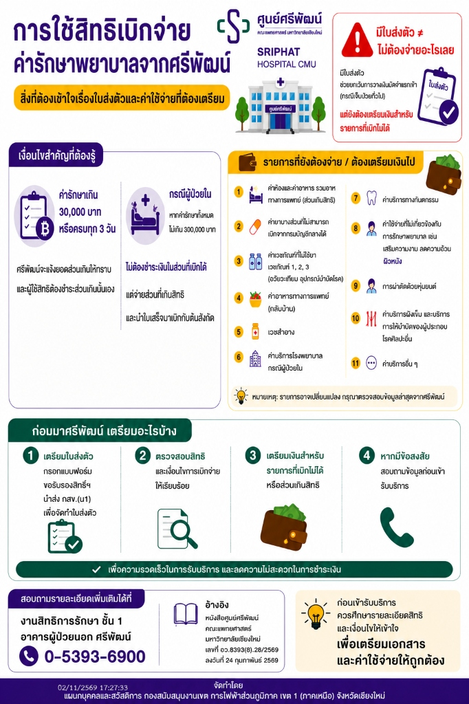

# การวางเงินมัดจำและการชำระค่ารักษาพยาบาลส่วนเกินสิทธิ ศูนย์ศรีพัฒน์ มช.

> **อ้างอิง:** หนังสือศูนย์ศรีพัฒน์ คณะแพทยศาสตร์ มหาวิทยาลัยเชียงใหม่ ที่ อว 8393(8).28/2569 ลงวันที่ 24 กุมภาพันธ์ 2569
> **เรียน:** ผู้อำนวยการกองสวัสดิการการไฟฟ้าส่วนภูมิภาค เขต 1 (ภาคเหนือ)
> **จัดทำอินโฟกราฟิกโดย:** แผนกบุคคลและสวัสดิการ กองสนับสนุนงานเขต การไฟฟ้าส่วนภูมิภาค เขต 1 (ภาคเหนือ) จังหวัดเชียงใหม่

---

## สาระสำคัญ: มีใบส่งตัว ≠ ไม่ต้องจ่ายอะไรเลย

มีใบส่งตัวช่วย **ยกเว้นการวางเงินมัดจำแรกเข้า (กรณีเจ็บป่วยทั่วไป)** แต่ผู้ใช้สิทธิ **ยังต้องเตรียมเงินสำหรับรายการที่เบิกไม่ได้ หรือรายการส่วนเกินสิทธิ**

---

## 1. เงื่อนไขการวางเงินมัดจำและชำระค่ารักษาพยาบาลส่วนเกินสิทธิ

1. **การยกเว้นเงินมัดจำแรกเข้า:**
   - กรณีใช้หนังสือส่งตัวรับรองสิทธิ พนักงานและบุคคลในครอบครัวจะได้รับการยกเว้นการวางเงินมัดจำแรกเข้ารับการรักษาพยาบาล (กรณีเจ็บป่วยทั่วไป)
2. **การแจ้งยอดส่วนเกินสิทธิ (เกณฑ์ 30,000 บาท หรือ 3 วัน):**
   - หากยอดค่ารักษาพยาบาลส่วนที่เกินกว่าวงเงินหรือสิทธิที่ระบุไว้ในหนังสือส่งตัว **ครบจำนวน 30,000 บาท หรือครบทุก 3 วัน**
   - ศูนย์ศรีพัฒน์ฯ จะแจ้งยอดส่วนเกินให้พนักงานหรือบุคคลในครอบครัวทราบ และผู้ใช้สิทธิต้องดำเนินการชำระส่วนเกินนั้นเอง
3. **กรณีผู้ป่วยใน (IPD):**
   - หากค่ารักษาพยาบาลทั้งหมด **ไม่เกิน 300,000 บาท:** ไม่ต้องชำระเงินในส่วนที่เบิกได้ แต่จ่ายเฉพาะส่วนที่เกินสิทธิ แล้วนำใบเสร็จมาเบิกกับต้นสังกัด
   - หากค่ารักษาพยาบาลทั้งหมด **เกิน 300,000 บาท:** สามารถตัดรอบการวางบิลและชำระเงินเป็นงวดได้

---

## 2. รายการค่ารักษาพยาบาล 11 รายการที่ศูนย์ศรีพัฒน์เรียกเก็บจากผู้มีสิทธิ (ต้องเตรียมเงินไป)

1. **ค่าห้องและค่าอาหาร:** รวมอาหารทางการแพทย์ (ส่วนเกินสิทธิที่ระบุในหนังสือส่งตัวรับรองสิทธิ)
2. **ค่ายาบางส่วน:** ที่ไม่สามารถเบิกจ่ายได้จากกรมบัญชีกลาง
3. **ค่าเวชภัณฑ์ที่มิใช่ยา:** เวชภัณฑ์ 1, เวชภัณฑ์ 2, เวชภัณฑ์ 3 (อวัยวะเทียมและอุปกรณ์บำบัดโรค)
4. **ค่าอาหารทางการแพทย์ (นำกลับบ้าน)**
5. **เวชสำอาง**
6. **ค่าบริการโรงพยาบาลกรณีผู้ป่วยใน**
7. **ค่าบริการทางทันตกรรม**
8. **ค่าใช้จ่ายที่ไม่เกี่ยวข้องกับการรักษาพยาบาล:** เช่น เสริมความงาม, ลดความอ้วน, คลินิกผิวหนัง
9. **การผ่าตัดด้วยหุ่นยนต์**
10. **ค่าบริการฝังเข็ม:** และบริการการให้บำบัดของผู้ประกอบโรคศิลปะอื่น
11. **ค่าบริการอื่น ๆ**

*(หมายเหตุ: รายการอาจมีการเปลี่ยนแปลง กรุณาตรวจสอบข้อมูลล่าสุดกับศูนย์ศรีพัฒน์ก่อนรับบริการ)*

---

## 3. ขั้นตอนการเตรียมตัว 4 ขั้นตอนก่อนมารับบริการที่ศูนย์ศรีพัฒน์

1. **เตรียมใบส่งตัว:** กรอกแบบฟอร์มขอรับรองสิทธิฯ นำส่ง กสข.(น1) เพื่อจัดทำใบส่งตัว
2. **ตรวจสอบสิทธิ:** และเงื่อนไขการเบิกจ่ายให้เรียบร้อย
3. **เตรียมเงิน:** สำหรับรายการที่เบิกไม่ได้หรือส่วนเกินสิทธิ
4. **สอบถามข้อสงสัย:** สอบถามข้อมูลก่อนเข้ารับบริการเพื่อความรวดเร็วและลดความไม่สะดวกในการชำระเงิน

---

## 4. ช่องทางติดต่อและสอบถามเพิ่มเติม

- **งานสิทธิการรักษา:** ชั้น 1 อาคารผู้ป่วยนอก ศูนย์ศรีพัฒน์ คณะแพทยศาสตร์ มหาวิทยาลัยเชียงใหม่
- **โทรศัพท์:** 0-5393-6900
- **แผนกการเงิน (สำนักงาน):** โทร. 0-5393-6919
- **อีเมล:** sriphat.financeoffice@gmail.com
